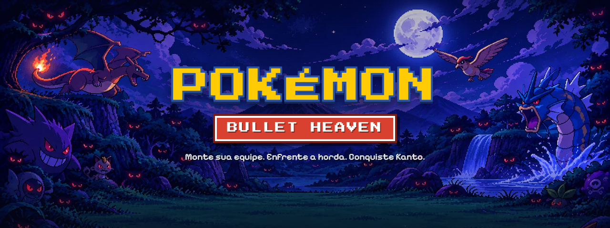

<p align="center">
  
</p>

<h1 align="center">Pokémon Bullet Heaven</h1>

<p align="center">
  <b><a href="https://fellipeperes.github.io/pokemon-bullet-heaven/">▶ JOGAR AGORA NO NAVEGADOR</a></b>
</p>

<p align="center">
  Um <i>Bullet Heaven</i> (estilo Vampire Survivors / Survivor.io) com estrutura de jornada Pokémon.<br />
  HTML + CSS + JavaScript puro. Sem instalação, sem backend, sem dependências.
</p>

---

## O jogo

Você é um treinador atravessando Kanto: **menino ou menina**, com o **seu nome**,
você escolhe no começo, como no FireRed. **O treinador não luta** — ele só anda.
Quem combate são os **Pokémon da sua equipe**, que atacam sozinhos enquanto você
se preocupa com posicionamento, composição e build.

Cada fase é a **jornada inteira até um ginásio**: você cruza as rotas daquele
trecho enfrentando hordas de Pokémon selvagens, captura novos companheiros, sobe o
nível de cada um e, no fim, encara o **time do líder do ginásio**, um Pokémon de
cada vez, até o ace dele.

A ideia é simples: *"estou fazendo uma jornada Pokémon enquanto construo uma build
de Bullet Heaven"*. Você começa fraco, com um único inicial, e termina a fase com
uma equipe de seis, evoluída, com golpes melhorados e sinergias que você escolheu.

**Entre uma fase e outra, a vila.** A jornada começa no seu quarto, numa mini-vila
feita com os tiles do FireRed, onde você anda em grade, como no jogo. Lá o
**Prof. Carvalho** conta por que as rotas estão tomadas por hordas e te dá o
**primeiro Pokémon**. Até falar com ele, as saídas da vila ficam fechadas. No
**Centro Pokémon**, a enfermeira cuida do PC e um vendedor tem o Poké Mart. A **loja de
Pokédolls** vende bonecos e móveis para decorar o seu quarto, e os moradores têm
o que contar. A saída sul abre o mapa da jornada; o mato alto a oeste e a lagoa
guardam modos que ainda estão por vir.

**O sonho e a missão.** Você quer ser o Campeão de Kanto, mas o Carvalho conta que
as hordas mudaram, e que o ideal mesmo seria devolver a paz às rotas. Uma história
própria corre junto da jornada, guiada pelas **quests** no canto de cima da tela
("Fale com a mãe 0/1"): elas mostram o próximo passo e comemoram cada um que fica
para trás.

## Como jogar

| Ação | Tecla |
|---|---|
| Mover o treinador | `WASD` ou setas |
| Trocar o Pokémon em campo | `1` – `6` (ou clique no card) |
| Escolher quem sai na troca (o card marcado "⇄ sai") | `Tab` ou clique no card |
| Ligar ou desligar o ataque de um Pokémon em campo | botão da espadinha no card (desligado, ele só acompanha) |
| Opções e volume da música | Opções na barra do topo, ou a engrenagem no canto (na partida, ao lado da pausa) |
| Gastar os níveis acumulados de um Pokémon | botão `▲` no card |
| Pausar / fechar janela | `ESC` |
| Controle (gamepad) | analógico ou direcional anda · LB/RB escolhem o slot · X/Y/B põem a reserva em campo · Start pausa · nas telas, direcional e A |

Na vila:

| Ação | Tecla |
|---|---|
| Andar (um tile por passo; tocar só vira) | setas ou `WASD`, ou clique onde quer ir |
| Correr | segure `Shift` (ou `X`) |
| Ação: falar, ler, entrar, avançar o texto | `Espaço` (ou `Enter` e `Z`), ou clique na pessoa |
| Responder NÃO / voltar | `X` ou `Backspace` |
| Controle (gamepad) | direcional anda · A fala · B segurado corre · Start abre o mapa da jornada |

Os ataques são automáticos. O que você controla é **onde estar**, **quem está em
campo** e **quais melhorias escolher**.

> O progresso fica salvo no navegador e também pode ser exportado como arquivo
> `.json` pelo botão **Salvar** (na vila e no mapa da jornada) ou dormindo na cama do
> quarto — dá para levar sua jornada para outra máquina.

## Os sistemas

**Equipe de 6, três em campo.** Os três ativos lutam ao mesmo tempo, orbitando o
treinador. Os outros três descansam e **recuperam vida** na reserva. Trocar tem
cooldown e é a principal forma de sustentar a equipe.

**Vida e nível por Pokémon.** O treinador não tem vida: quem toma dano são os
Pokémon, cada um com sua barra. Quem cai **desmaia até o fim da fase** e é
substituído automaticamente. Se os seis caírem, a fase é perdida.

**Experiência dividida.** O XP de cada inimigo é repartido pela equipe: **25% para
cada Pokémon em campo** e **8,33% para cada um da reserva**. Ninguém fica para trás,
mas quem luta cresce mais rápido.

**Melhorias a cada 3 níveis.** Pokémon ativo que sobe pausa a partida para você
escolher; o da reserva **acumula** e você gasta quando quiser, pelo botão `▲`.
As melhorias valem só para aquele Pokémon: mais dano, mais projéteis, mais área,
recarga menor, efeitos de status.

**Evolução fiel aos jogos.** Charmander vira Charmeleon no nível 16 e Charizard no
36; Bulbasaur e Squirtle seguem 16/32 e 16/36; Magikarp vira Gyarados no 20. Evoluir
mantém golpe e melhorias e cura toda a vida. Do nível 11 em diante, subir de nível
cura 1/10 da vida.

**TMs — a linha de 3 golpes.** Cada espécie tem a própria linha de evolução de
golpe. Charmander é `Ember → Flamethrower → Fire Blast`; Pidgey é
`Gust → Wing Attack → Hurricane`; Machop é `Karate Chop → Seismic Toss → Cross Chop`.
O golpe sobe principalmente na **evolução** (Charmeleon já chega com Flamethrower)
e, mais raramente, por uma TM no level up. Nos dois casos ele vai para **o próximo
da linha daquele Pokémon** — nunca um golpe aleatório de outro — e **leva junto
todas as melhorias já investidas**. Trocar de golpe nunca é um downgrade.

**Captura.** Inimigos derrotados podem deixar uma Poké Ball. Ao coletar, o jogo
pausa e oferece quatro Pokémon sorteados pela tabela de chances daquela fase. Cada
fase tem um teto de bolas, e a primeira tem duas garantidas, para o inicial não
ficar sozinho. Com a equipe cheia, nada se perde: quem sai (ou quem chega) vai para
o PC.

**Shards.** Vêm dos chefes (10 por Pokémon de líder, 5 por chefe simples, mesmo
numa derrota), da **primeira** vitória de cada fase e das conquistas. Gaste no
**Poké Mart** (o balcão do Centro Pokémon, na vila, ou o botão no mapa da jornada):
Novo Sorteio (300) e Reviver (600) vão para a mochila; a TM (1.500) ensina o
próximo golpe na hora; a TM Dive (1.500), que só aparece quando um Pokémon de
Água já tem o Golpe Desperto, troca esse golpe por Dive para sempre (e, com Dive na equipe, a lagoa da vila leva a uma descida pelo fundo do mar e a um segredo lá embaixo); as pedras e o Cabo de Troca (2.500) são a única forma de
evoluir quem evolui por item (Pikachu, Eevee, Kadabra, Gloom...). E na loja de
Pokédolls, nos enfeites do quarto.

**A jornada continua.** Equipe, níveis e build passam de uma fase para a seguinte.
Perder não tira nada: o que a equipe ganhou na tentativa fica, só a próxima fase
não abre até você vencer.

## Conteúdo atual

- **Kanto inteira, 13 etapas** — os 8 ginásios (Brock, Misty, Lt. Surge, Erika,
  Koga, Sabrina, Blaine e Giovanni), a Elite Four (Lorelei, Bruno, Agatha e Lance)
  e o Campeão, cada líder com o time do FireRed. O time do rival muda conforme o
  seu inicial, como no jogo.
- **Treinador à sua escolha**: menino ou menina, com o seu nome, os sprites de andar
  e correr do FireRed e o Prof. Carvalho fazendo as perguntas.
- **A Vila da Jornada** (0.29): o lobby jogável, montado com os mapas do FireRed. São 7
  interiores (a sua casa e o quarto, o laboratório do Carvalho, o Centro Pokémon com
  dois balcões, a loja de Pokédolls, a cabana e a casa do velho sábio), 17 moradores e
  Pokémon com falas que mudam com a jornada, e um quarto que você decora com 10 enfeites.
- **A história e as quests** (0.38): o rastreador no canto de cima da vila e do mapa da
  jornada (e uma linha na partida) guia o prólogo, do quarto ao laboratório do
  Carvalho e daí ao Brock. Ao fechar uma quest, o ✓ e o "Missão concluída!", e a
  próxima entra deslizando. A história completa está em
  [PLANEJAMENTO-HISTORIA.md](PLANEJAMENTO-HISTORIA.md) e chega por capítulos.
- **As cenas** (0.39): o Carvalho encena o discurso do prólogo, e o rival chega
  atrasado ao laboratório para pegar o inicial com vantagem sobre o seu. As cenas
  são roteiros em dados, com câmera, gente andando, itens e quests. A história
  acontece antes e depois das fases, nunca no meio delas, sempre em tela cheia: depois
  da Fase 1, no ginásio dele, o Brock pede a sua ajuda para entender o que está
  acontecendo com os Pokémon, e de volta à vila o velho sábio conta que os
  pássaros lendários sumiram dos céus. Em Cerulean, a Misty conta que o mar ficou
  bravo desde que o Articuno sumiu, e uma casa assaltada põe a culpa na Equipe
  Rocket. Em Vermilion, o Lt. Surge conta que o Zapdos também sumiu, na noite em que
  a Usina apagou, e um marinheiro escutou correntes lá dentro: a Usina aparece no
  mapa da jornada, e o jogador entra para explorar o labirinto, pegar Poké Balls e
  achar a escotilha para o fundo, onde dois olhos vermelhos esperam no escuro.
- **A missão do Zapdos**: no fundo da Usina, ele está acorrentado a uma máquina com um
  emblema vermelho, que suga a energia dele e manda para longe, em ondas. Enfraquecido,
  ele é uma luta para logo depois da Fase 3. A horda elétrica vem, as correntes
  arrebentam e ele luta com uma tempestade de raios marcados no chão, o Zap Cannon,
  investidas e um tabuleiro de raios em que só fica a salvo quem pisa onde o raio acabou
  de cair. Derrotado, ele foge, assustado: a captura fica para outro momento (por
  enquanto, nenhum lendário aparece nas Poké Balls das fases).
- **O emblema de novo**: o caminho para Celadon passa pelo Túnel de Pedra, no escuro
  desde o apagão; ele só acende quando a luz volta à Usina. Depois da Erika, ela conta da
  tempestade daquela noite (a lembrança: uma sombra de asas cruzando o céu) e mostra o
  pedaço de metal que achou no jardim, com o mesmo emblema da máquina da Usina. Depois,
  a jornada segue pelo Koga e pela Sabrina.
- **As ondas e o Articuno**: depois da Fase 7, o Blaine conta que os instrumentos dele
  captam ondas estranhas saindo das Ilhas Seafoam, e que o mar em volta está
  congelando: nenhum barco sai de Cinnabar, e a Fase 8 espera. O jogador desce a pé os
  cinco andares das ilhas, como no FireRed (os patamares só se ligam pelas escadinhas,
  e os buracos levam para baixo), até a margem do fundo, onde a névoa se abre sobre uma
  máquina coberta de gelo com o Articuno acorrentado. A luta tem a névoa que esconde a
  horda, o gelo no chão que deixa o treinador lento, o Raio de Gelo, a Nevasca e o Frio
  Absoluto, em que só o olho da nevasca fica livre. Derrotado, ele foge, o mar
  descongela, e o jogador volta direto para a vila. Pelo caminho, 15 Poké Balls.
- **O Giovanni e o Moltres**: depois da Fase 8, o jogador mostra o Pedaço de Metal ao
  Giovanni, que ri: não é da Rocket, e ele também quer saber quem é. Os homens dele viram
  o emblema subindo o Monte Brasa, na Ilha 1. A Liga fecha a Victory Road, tomada por
  hordas furiosas. O jogador sobe a montanha a pé, como no FireRed, pulando os degraus do
  caminho (as pedras grandes já foram arrastadas pelos ladrões), até o cume, onde uma
  máquina em brasa prende o Moltres. A luta tem o Sol forte (Fogo mais forte, Água mais
  fraca), o chão em brasa, o Lança-chamas que varre, o Redemoinho de Fogo com uma saída
  só e o Fogo Sagrado, em que só a sombra das rochas protege. Derrotado, ele foge, e a
  Liga reabre. Pelo caminho, 15 Poké Balls.
- **A tela de Missões**: o Diário na barra, ao lado das Conquistas. Em cima, o que
  fazer agora; embaixo, o que já aconteceu, capítulo por capítulo, com a data de cada
  missão, para reler a história; no fim, os itens importantes que ela deu. Um
  pontinho avisa quando abre uma missão nova.
- **Os 151 Pokémon de Kanto jogáveis**, cada um com linha de 3 golpes e linha
  evolutiva. Alguns chegam como presente, como no FireRed (Farfetch'd, Lickitung e
  o prêmio do Dojo de Saffron: Hitmonlee ou Hitmonchan).
- **52 golpes** com o sprite da animação do FireRed, no máximo 4 por tipo, sobre 7
  comportamentos genéricos (projétil, arco, órbita, aura, zona de chão, onda de
  choque e raio em corrente), fora os 51 do Golpe Desperto (mais o Dive, que vem da TM Dive) e os 5 exclusivos dos
  lendários (abaixo).
- **Cenário do FireRed**: cada trecho da jornada é montado com as metatiles do lugar
  (a grama e as árvores da Rota 1, a mata da Floresta de Viridian, o Monte Lua) e
  cada ginásio e sala da Liga tem o visual do mapa original. O andar continua livre,
  mas árvores, pedras, paredões e estátuas bloqueiam o caminho (seu e dos selvagens).
- **Ímã**: raríssimo, cai de alguns Pokémon e, ao ser pego, puxa todo o XP do mapa até você.
- **Líderes de verdade**: cada um com muito mais vida, rajadas de projéteis mirando
  você e uma fase de fúria abaixo da metade da vida.
- **Visual de GBA**: as janelas e botões do FireRed, fontes em pixel e o fundo dos
  menus montado com o próprio cenário do jogo.
- **Música do FireRed**: uma por fase, a do líder, a da vitória, a do Centro
  Pokémon, a do Hall da Fama e o tema do lobby (nos menus e na vila), com volume
  ajustável.
- **O mapa da jornada no Town Map de Kanto** (pela saída sul da vila): cada fase na
  cidade do ginásio, o treinador andando pelo mapa, a fase escolhida ao lado (o
  salão do líder em pixel, o time dele em Poké Balls, a que tipos ele é fraco e o
  nível recomendado) e o **Estojo de Insígnias** (o Cartão de Treinador do FireRed)
  com as métricas de cada fase.
- **Cards de escolha**: o inicial e os Pokémon da Poké Ball aparecem em pixel na
  base de batalha, com barras de vida, dano por segundo e alcance tiradas dos dados.
- **Tipos de verdade**: a tabela da série vale no dano que você causa e no que os seus
  Pokémon recebem (a queimadura e o veneno também). O painel da fase mostra a que o
  time do líder é **fraco**, e o jogo avisa o golpe super efetivo. Montar o time
  pensando em tipos vira os confrontos difíceis.
- **Golpe Desperto**: cada golpe tem uma **chave** de 3 melhorias (o Hydro Pump do
  Gyarados: Velocidade, Perfuração e Potência; o Toxic do Gloom: Amplitude,
  Intensidade e Reflexo). Elas aparecem em dourado na tela de nível, com o aviso
  "maximize para liberar"; com
  as 3 no máximo, cada nível que ele sobe tem 4% de chance de despertar um golpe a
  mais do tipo dele (51 ao todo: Flame Wheel, Whirlpool, Draco Meteor...), que usa
  junto do dele. As outras
  melhorias continuam valendo; com todas no máximo, cada nível de melhoria cura
  20% sozinho, sem abrir tela.
- **Lendários**: Articuno, Zapdos, Moltres, Mewtwo e Mew têm um golpe exclusivo
  (Sheer Cold, Zap Cannon, Sacred Fire, Psystrike e Metronome) e já chegam com
  melhorias e o Golpe Desperto. Por enquanto, nenhum deles aparece na Poké Ball:
  a captura dos lendários espera a história (os pássaros fogem depois das missões).
- **Shiny**: raro (1%), na captura e no inicial — o card da Poké Ball brilha, e o
  Pokémon fica com as cores raras no campo, no PC e na Pokédex.
- **Modo Livre**: ao vencer uma fase, dá para seguir nela sem fim, com XP
  reduzido e inimigos cada vez mais fortes, até ficar quase impossível. O botão
  "Voltar para o Centro Pokémon", no canto, sai guardando o que a equipe ganhou.
- **Jornadas**: até 3 ao mesmo tempo, cada uma com o seu treinador e nome,
  inicial, insígnias e equipe. No título, **Jornada** mostra os espaços (Jogar,
  Apagar ou começar outra) e **Nova jornada** abre uma sem apagar as outras. A
  Pokédex, as conquistas, os Shards, a mochila e o quarto valem para todas.
- **Derrota sem perda**: o que a equipe ganhou na tentativa (níveis, melhorias,
  evoluções e capturas) fica; só a próxima fase não abre. No Centro Pokémon a
  equipe é curada e você tenta de novo, ou rejoga fases anteriores para upar.
  Recomeçar a jornada do zero fica em Opções → Reiniciar a jornada, que pergunta
  antes. O
  mapa da jornada mostra o **nível recomendado** de cada fase ao lado do nível da
  sua equipe.
- **Pokédex na captura**: quem você já registrou aparece com uma Poké Ball ao
  lado do nome.
- **PC do FireRed**: com a equipe cheia, nada se perde — quem sai (ou quem chega)
  vai para o PC. Na vila (com a enfermeira do Centro) e no mapa da jornada, o PC é
  o do jogo: caixas com papel de parede, a mão como cursor, pegar e soltar para
  montar a equipe da próxima fase.
- **Conquistas em níveis**: 20 conquistas, cada uma com vários degraus — ao coletar,
  ela volta com um objetivo maior e mais Shards.
- Fases curtas: 2:45 até o líder, cerca de 3 minutos com a luta.
- **Pokédex de Kanto** (151) que se preenche conforme você captura e evolui.
- A dificuldade e a quantidade de inimigos sobem fase a fase: os selvagens ganham
  nível junto com a sua equipe, e o teto da horda vai de ~90 inimigos na Fase 1 a
  ~250 no Campeão.

## Rodando localmente

O jogo usa ES Modules, então precisa ser servido por HTTP (abrir o `index.html`
com duplo clique não funciona por causa do CORS).

```bash
git clone https://github.com/FellipePeres/pokemon-bullet-heaven.git
cd pokemon-bullet-heaven

npm run dev               # http://localhost:5173
# ou: python -m http.server 5173
# ou: extensão Live Server do VS Code
```

Não há dependências para instalar — `npm run dev` só sobe um servidor estático.

### Testes

```bash
npm test                  # roda os três
npm run check             # dados: evoluções, linhas de golpe, inimigos, pools
npm run smoke             # lógica: fases inteiras simuladas, sem navegador
npm run smoke:ui          # interface: DOM simulado a partir do index.html real
```

O `smoke` joga as fases do começo ao fim com um "jogador virtual" que foge da
horda, pega Poké Balls, troca Pokémon machucado e escolhe melhorias — é assim que o
balanceamento é medido.

## Estrutura

```
index.html        página única          css/style.css     interface
src/
  core/           config e utilidades   ⭐ config.js = todo o balanceamento
  data/           CONTEÚDO do jogo      ⭐ só dados, sem lógica
  entities/       treinador, Pokémon, inimigos, projéteis, áreas, itens
  systems/        comportamento genérico (combate, habilidades, spawn, equipe...)
  game/           Run (uma partida), Hub (a vila) e Game (orquestração)
  render/         canvas (a partida e a vila), sprites e ícones
  ui/             HUD, menus, janelas, o mapa da jornada e o PC
  audio/          a música
  save/           arquivo .json, progresso permanente e opções
tools/            testes, o jogador virtual, o balance, os screenshots e os extratores de assets (assets/)
```

A regra do projeto: **`/data` é conteúdo, `/systems` é comportamento**. Adicionar
um Pokémon, habilidade, inimigo, fase ou conquista é editar `/data` — os upgrades
de cada habilidade nova, por exemplo, são gerados automaticamente.

📄 **[HANDOFF.md](HANDOFF.md)** tem o estado detalhado do desenvolvimento: decisões
de design e o porquê de cada uma, balanceamento medido, armadilhas já resolvidas e
os próximos passos.

## Créditos

Os sprites animados da interface (Gen V), os ícones de item e as insígnias vêm do
repositório público [PokeAPI/sprites](https://github.com/PokeAPI/sprites). Sem
internet, o jogo desenha versões procedurais e a interface cai para ícones simples.

Os treinadores (andar, correr e retratos), os golpes, o cenário, a vila, o PC, o Town
Map, os sprites dos cards, a caixa de texto e as músicas vêm do FireRed, pelo decomp
[pret/pokefirered](https://github.com/pret/pokefirered); os Pokémon animados em campo
são os GIFs da Gen 5 do Pokemon All. Tudo fica em `assets/`.
A procedência de cada arquivo está em [assets/PROVENIENCIA.md](assets/PROVENIENCIA.md).

> **Projeto de fã, sem fins lucrativos.** Pokémon e todos os nomes relacionados são
> marcas registradas da Nintendo, Game Freak e The Pokémon Company. Este projeto não
> é afiliado a elas e não é vendido nem monetizado.
